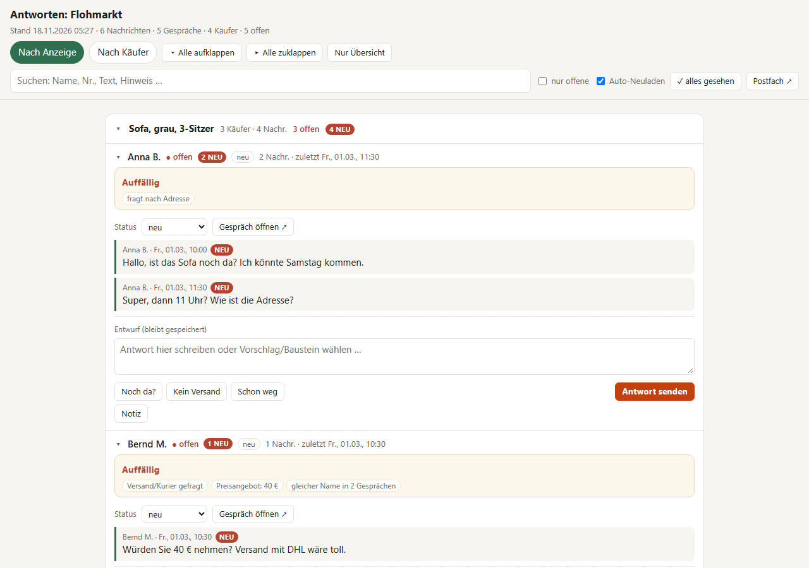

# kleinanzeigen-antworten

> **Kurz erklärt**
>
> Du verkaufst etwas auf Kleinanzeigen, und viele Leute schreiben Dir. Jede Nachricht kommt
> auch als E-Mail bei Dir an. Dieses Programm liest diese E-Mails und macht daraus eine
> übersichtliche Seite: wer hat was gefragt, wer wartet noch auf Antwort, und wo ist Vorsicht
> geboten (zum Beispiel "zahle per PayPal, schreib mir auf WhatsApp"). Mit einem Klick landest
> Du im richtigen Gespräch auf Kleinanzeigen und antwortest dort wie gewohnt.
>
> Das Programm meldet sich nie bei Kleinanzeigen an und schickt nichts ab. Dein Konto kann
> dadurch nicht gesperrt werden. Alles bleibt auf Deinem Rechner.

**Deutsch** · [English](#english)


*Beispiel mit erfundenen Käufern. Gelb: Hinweise, auf die Du achten solltest.*

## Was es macht

- Alle Gespräche auf einer Seite, nach Anzeige oder nach Käufer sortiert.
- Neue Nachrichten stehen oben und sind rot markiert.
- Warnhinweise: PayPal, Versand, Telefonnummer, Links, Preisangebot, gleicher Name in mehreren Gesprächen.
- Antwortvorlagen mit einem Klick ("Noch da?", "Kein Versand", "Schon weg").
- **Antwort senden** kopiert Deinen Text und öffnet genau dieses Gespräch auf kleinanzeigen.de.
  Dort fügst Du ihn ein und schickst ihn selbst ab.

## Warum es anders ist

Es gibt andere Werkzeuge für Kleinanzeigen. Die meisten melden sich mit Deinem Konto an oder
steuern die Website. Dieses *liest* nur die Benachrichtigungs-E-Mails: entweder legst Du sie selbst in einen Ordner,
oder es holt sie automatisch aus Deinem Postfach (IMAP, nur lesend). Es braucht also kein Login,
birgt kein Risiko für Dein Konto und berührt Kleinanzeigen nie.

## So geht's (einfach)

### Teil 1: Einmal einrichten

*Nur beim ersten Mal, etwa 2 Minuten. Windows.*

1. **Programm herunterladen.** Unter [Releases](https://github.com/capraCoder/kleinanzeigen-antworten/releases/latest)
   die Datei **`ka-antworten.exe`** herunterladen und auf den Schreibtisch legen.
2. **Einmal doppelklicken.** Das Programm legt auf dem Schreibtisch den Ordner `Kleinanzeigen` an.
   Warnt Windows ("Der Computer wurde durch Windows geschützt"), klicke auf **"Weitere Informationen"**
   und dann **"Trotzdem ausführen"**. Das Programm ist neu und noch nicht signiert.

*macOS oder Linux:* Python 3.11+ installieren, dann `pip install ka-antworten`.

### Teil 2: Neue Nachrichten holen

*Jedes Mal, wenn neue Kleinanzeigen-Mails da sind.*

1. **Mails in den Ordner `Kleinanzeigen` legen.**
   - *Thunderbird oder Outlook:* Kleinanzeigen-Mails markieren und mit der Maus in den Ordner ziehen.
   - *Gmail im Browser:* Mail öffnen, oben rechts auf ⋮ und **"Nachricht herunterladen"**, dann in den Ordner legen.
2. **`ka-antworten.exe` doppelklicken.** Die Seite öffnet sich im Browser, fertig.
   (Mit pip: im Ordner über `Kleinanzeigen` einfach `ka-antworten` eintippen.)

Nur mal schauen, wie es aussieht? Das Bild oben zeigt es mit erfundenen Käufern.

## Für Fortgeschrittene

<details>
<summary>Postfach direkt lesen, Vorlagen, Demo, Tests</summary>

**Direkt aus dem Postfach (IMAP, nur lesend).** `config.example.toml` nach `config.toml` kopieren,
unter `[imap]` Server und Benutzer eintragen. Das Passwort steht nie in der Datei: es kommt aus
`KA_IMAP_PASSWORD` oder wird abgefragt. Gmail braucht ein App-Passwort. Der Ordner wird mit
`readonly` und `BODY.PEEK` geöffnet: keine Mail wird verändert, nicht einmal als gelesen markiert.

```bash
ka-antworten --imap --config config.toml
```

**Eingaben:** `.eml`, `.mbox` (Thunderbird, Google Takeout) oder Ordner davon; `--out` wählt die Ausgabedatei.

**Einstellungen** in `config.toml`: Titel, volle Namen, Anzeigennamen, Antwortvorlagen, Countdown mit Phasen.

**Anzeigen-Vorschau.** Ein Klick auf einen Anzeigentitel (oder das Anzeigen-Kärtchen in der
Käufer-Ansicht) öffnet ein Fenster: alle Gespräche zu dieser Anzeige mit Sprung dorthin und die
letzte Nachricht. Mit `[ad_details."<Nr>"]` in `config.toml` kommen Preis, Anzeigentext, Link und
Fotos dazu. Fotos sind Dateien neben der Seite oder `https://`-Adressen, andere Links werden
verworfen.

**Demo und Tests** (im Quellordner):

```bash
python -m tests.fake && ka-antworten tests/demo.mbox --out demo.html
python -m unittest
```

</details>

## Datenschutz

Die Seite enthält Namen und Nachrichten Deiner Käufer. Teile sie nicht. Nachnamen werden
standardmäßig abgekürzt ("Anna B."). Die `.gitignore` schließt Seiten, `config.toml` und
Mail-Exporte aus.

Dieses Projekt ist nicht mit Kleinanzeigen verbunden. "Kleinanzeigen" ist eine Marke ihres Inhabers.

---

## English

> **In short**
>
> You sell things on Kleinanzeigen, Germany's largest classifieds site, and many people message
> you. Each message also arrives as an e-mail. This program reads those e-mails and turns them
> into one tidy page: who asked what, who is still waiting, and where to be careful. One click
> takes you to the right conversation on Kleinanzeigen, where you reply as usual.
>
> It never logs in to Kleinanzeigen and never sends anything. Your account cannot be banned
> because of it. Everything stays on your computer.


*Example with invented buyers. Yellow: hints you should watch out for.*

## What it does

- All conversations on one page, sorted by ad or by buyer.
- New messages are at the top and marked red.
- Warning hints: PayPal, shipping, phone number, links, price offer, same name in several conversations.
- Reply templates with one click ("Still available?", "No shipping", "Already gone").
- **Send reply** copies your text and opens exactly this conversation on kleinanzeigen.de.
  There you paste it and send it yourself.

## Why it is different

There are other tools for Kleinanzeigen. Most of them log in with your account or control the
website. This one only *reads* the notification e-mails: either you put them into a folder
yourself, or it fetches them automatically from your mailbox (IMAP, read-only). So it needs no
login, carries no risk for your account and never touches Kleinanzeigen.

## How it works (easy)

### Part 1: Set up once

*Only the first time, about 2 minutes. Windows.*

1. **Download the program.** Under [Releases](https://github.com/capraCoder/kleinanzeigen-antworten/releases/latest)
   download the file **`ka-antworten.exe`** and put it on your desktop.
2. **Double-click it once.** The program creates the folder `Kleinanzeigen` on your desktop.
   If Windows warns you ("Windows protected your PC"), click **"More info"** and then
   **"Run anyway"**. The program is new and not yet signed.

*macOS or Linux:* install Python 3.11+, then `pip install ka-antworten`.

### Part 2: Get new messages

*Every time new Kleinanzeigen mails have arrived.*

1. **Put the mails into the `Kleinanzeigen` folder.**
   - *Thunderbird or Outlook:* select the Kleinanzeigen mails and drag them into the folder with the mouse.
   - *Gmail in the browser:* open the mail, click ⋮ at the top right and **"Download message"**, then put it into the folder.
2. **Double-click `ka-antworten.exe`.** The page opens in your browser, done.
   (With pip: in the folder above `Kleinanzeigen`, simply type `ka-antworten`.)

Just want to see what it looks like? The picture above shows it with invented buyers.

## For advanced users

<details>
<summary>Read the mailbox directly, templates, demo, tests</summary>

**Directly from the mailbox (IMAP, read-only).** Copy `config.example.toml` to `config.toml`,
enter server and user under `[imap]`. The password is never in the file: it comes from
`KA_IMAP_PASSWORD` or is asked for. Gmail needs an app password. The folder is opened with
`readonly` and `BODY.PEEK`: no mail is changed, not even marked as read.

```bash
ka-antworten --imap --config config.toml
```

**Inputs:** `.eml`, `.mbox` (Thunderbird, Google Takeout) or folders of them; `--out` chooses the output file.

**Settings** in `config.toml`: title, full names, ad names, reply templates, countdown with phases.

**Ad preview.** A click on an ad title (or the ad card in the buyer view) opens a window: all
conversations for this ad with a jump to them and the last message. With `[ad_details."<Nr>"]`
in `config.toml` you add price, ad text, link and photos. Photos are files next to the page or
`https://` addresses; other links are dropped.

**Demo and tests** (in the source folder):

```bash
python -m tests.fake && ka-antworten tests/demo.mbox --out demo.html
python -m unittest
```

</details>

## Privacy

The page contains the names and messages of your buyers. Do not share it. Surnames are shortened
by default ("Anna B."). The `.gitignore` excludes pages, `config.toml` and mail exports.

This project is not affiliated with Kleinanzeigen. "Kleinanzeigen" is a trademark of its owner.

---

## Lizenz / Licence

**Deutsch.** Frei nutzen, verändern, weitergeben und forken. Lizenz: [MIT](LICENSE).
Wer es weitergibt oder darauf aufbaut, nennt bitte die Quelle mit dieser Zeile (zum Kopieren):

```
Based on kleinanzeigen-antworten by capraCoder (https://github.com/capraCoder/kleinanzeigen-antworten)
```

**English.** Use, change, share and fork it freely. Licence: [MIT](LICENSE).
If you share it or build on it, please credit it with this line (copy and paste):

```
Based on kleinanzeigen-antworten by capraCoder (https://github.com/capraCoder/kleinanzeigen-antworten)
```

---

## Haftungsausschluss / Disclaimer

**Deutsch.** Diese Software wird kostenlos und ohne jede Gewähr bereitgestellt ("wie besehen"),
siehe [LICENSE](LICENSE). Die Nutzung erfolgt auf eigenes Risiko. Für Schäden, Datenverlust,
entgangene Verkäufe oder Maßnahmen Dritter (z. B. Kontosperrungen) wird keine Haftung übernommen,
soweit gesetzlich zulässig. Du bist selbst verantwortlich für die Einhaltung der Nutzungsbedingungen
von Kleinanzeigen und Deines E-Mail-Anbieters sowie des Datenschutzrechts (DSGVO) beim Umgang mit
den Daten Deiner Käufer. Dieses Projekt ist kein offizielles Angebot von Kleinanzeigen und steht in
keiner Verbindung zu Kleinanzeigen; "Kleinanzeigen" ist eine Marke ihres Inhabers. Dies ist keine
Rechtsberatung.

**English.** This software is provided free of charge and "as is", without warranty of any kind;
see [LICENSE](LICENSE). You use it at your own risk. To the extent permitted by law, no liability is
accepted for damage, data loss, lost sales or actions by third parties (such as account
restrictions). You are responsible for complying with the terms of Kleinanzeigen and of your e-mail
provider, and with data-protection law (GDPR) when handling your buyers' data. This project is not
an official Kleinanzeigen product and is not affiliated with Kleinanzeigen; "Kleinanzeigen" is a
trademark of its owner. This is not legal advice.
